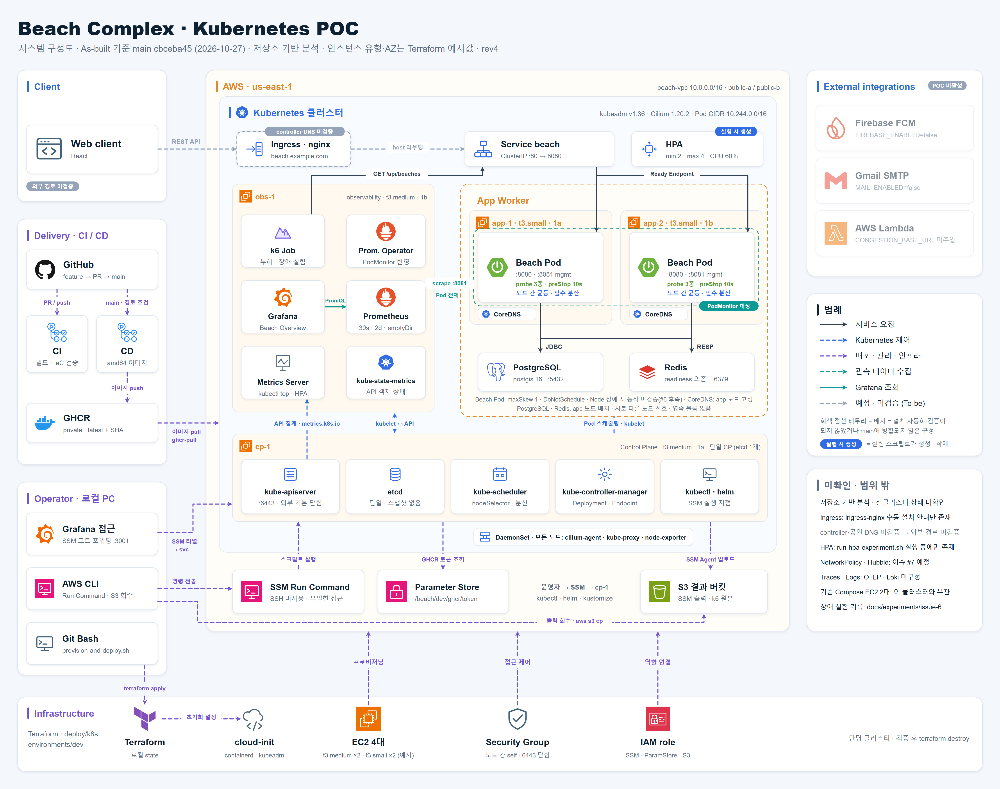

# Beach Complex — Kubernetes PoC

공공데이터를 바탕으로 전국 해수욕장 정보를 조회하고, 상태 정보, 즐겨찾기, 예약, 알림 기능까지 함께 제공하는 해수욕장 서비스 프로젝트입니다.  
이 저장소는 팀 프로젝트인 [원본 백엔드](https://github.com/Beach-complex/Beach_complex)를 기반으로, **단독으로 수행한 Kubernetes 운영 PoC**입니다. 원본 서비스의 개발 범위와 이 저장소에서 추가한 인프라 구성·실험 결과를 구분합니다.

## 프로젝트 개요

- 프로젝트 성격: 기존 팀 프로젝트 기반 개인 PoC (단독 수행)
- 목적: 기존 Spring Boot 서비스를 Kubernetes에 배포하고 배포·관측·장애 복구·CPU 기반 HPA 동작을 실험으로 확인
- 서비스 기반: 인증, 해수욕장 조회, 상태 정보 조회, 즐겨찾기, 예약, 알림
- PoC 주요 기술: Terraform, AWS EC2, kubeadm, Cilium, AWS Systems Manager(SSM), Prometheus/Grafana, Metrics Server, k6
- 운영 방식: 검증할 때 AWS 클러스터를 생성하고 결과 회수 후 삭제하는 PoC

## PoC 구성과 검토 범위

AWS EC2에 Control Plane 1대, App Worker 2대, Observability Worker 1대를 구성합니다. 앱과 관측 워크로드의 배치는 node label과 `nodeSelector`로 구분하고, 원격 작업은 SSM Run Command로 실행합니다.

`cbceba45`의 저장소 구성 기준이며 인스턴스 유형·AZ는 Terraform 예시값입니다. 실험 부하는 내부 Service 경로이고 외부 Ingress controller·DNS는 미검증입니다. HPA는 실험 중에만 생성하며, PostgreSQL·Redis는 각 1 replica로 App Worker 영역에 배치하되 서로 다른 노드 배치를 보장하지 않습니다.

| 노드 | 역할 | 예시 인스턴스 유형 |
| --- | --- | --- |
| `cp-1` | kubeadm Control Plane | t3.medium |
| `app-1`, `app-2` | Beach 앱, PostgreSQL·Redis, CoreDNS | 각 t3.small |
| `obs-1` | 관측 스택, Metrics Server, k6 부하 생성 | t3.medium |

구성 기준은 [Terraform 예시](./deploy/k8s/terraform/environments/dev/terraform.tfvars.example), 실행 환경 선택 근거와 K3s 비교는 [실행 환경 ADR](./docs/adr/k8s-execution-environment.md)에 기록합니다. 노드 역할 분리가 Node 장애 내성이나 클러스터 HA 검증 완료를 뜻하지는 않습니다.

Metrics Server는 HPA가 사용하는 resource metrics를 제공합니다. PostgreSQL·Redis의 서로 다른 App Worker 배치는 선호 조건(`preferred` Pod anti-affinity)이므로 보장되지 않습니다.

### 실험 기록

| 항목 | 기록된 결과와 범위 | 상세 근거 |
| --- | --- | --- |
| Rolling Update (#3) | 대표 회차 389건 모두 HTTP 200, dropped iteration 1건. 기본·조정 설정 비교는 현재 범위에서 제외 | [실행 조건·원본](./docs/experiments/issue-3/README.md) |
| Redis 장애와 readiness (#3) | ready endpoint 2→0→2 관찰. 요청 실패율 미측정 | [Pod·EndpointSlice 원본](./docs/experiments/issue-3/readiness-endpoint/README.md) |
| 관측성 (#5) | 5 req/s 단일 회차에서 Prometheus target 26개 up, k6 요약·Grafana 화면 보존 | [검증 출력·화면](./docs/experiments/issue-5/README.md) |
| Pod 장애 (#6 일부) | Pod 1개 강제 삭제 회차에서 2,101건 요청 실패 0건, 새 Pod Ready 관찰까지 64.56초. 이 시간은 서비스 중단 시간이 아님 | [회차별 결과·집계](./docs/experiments/issue-6/README.md) |
| CPU 기반 HPA (#4) | 120 req/s 설정 회차에서 실측 처리량 120.013 req/s, 71,999건 요청 실패 0건, Ready Pod 2→4→2 관찰. 40 req/s 첫 회차는 2→4→2, 반복 회차는 미확장으로 반복 재현 미확인·해당 회차 미통과 판정 유지 | [지연시간·replica 타임라인·반복 편차](./docs/experiments/issue-4/README.md) |

각 문서의 회차·실행 코드·원본 위치와 한계를 함께 확인합니다. #4와 #6의 전체 원본은 로컬 보관이며 Git에서 내려받을 수 없습니다. 요약 문서가 원본의 외부 접근성을 대체하지 않습니다.

### 한계와 후속 과제

- 단일 Control Plane이며 클러스터 전체 HA, 대규모 production 성능, 최대 수용량은 검증하지 않았습니다.
- 부하는 클러스터 내부 Service의 `GET /api/beaches` 경로 기준입니다. 외부 진입 경로와 다른 API의 성능으로 일반화하지 않습니다.
- HPA 확장·축소 관측과 지연 개선·병목 방지의 인과 효과를 구분합니다. 동일 조건의 고정 replica 대조 실험은 없습니다.
- PostgreSQL·Redis는 각 1 replica이며 영속 볼륨을 사용하지 않는 검증용 구성입니다. Redis는 앱 readiness에 포함됩니다. 관측·의존성 데이터의 보존 제약은 [비용·삭제·비밀정보 안내](./docs/kubernetes-ephemeral-cluster-cost-and-secrets.md)와 [의존성 배치 ADR](./docs/adr/ephemeral-dependency-placement.md)을 확인합니다.
- #6의 Node 장애 실측, #7 NetworkPolicy/Hubble, #18 분석 데모, #13 노드 자동확장은 후속 범위입니다. Cilium 사용을 NetworkPolicy/Hubble 검증 완료로 표현하지 않습니다.
- #8은 문서 정합성과 재현 절차를 검토하는 단계이며 전체 문서 검토·새 환경 재현 완료를 뜻하지 않습니다.

## 테스트와 협업

- 단위 테스트와 통합 테스트를 함께 운영합니다.
- Testcontainers를 사용해 데이터베이스 연동 테스트를 검증합니다.
- GitHub Actions에서 빌드, 테스트, 커버리지 리포트 업로드를 수행합니다.
- 원본 서비스의 협업 규칙·기술 결정·트러블슈팅은 `Beach-complex/docs`에서, PoC 운영·실험 문서는 이 저장소에서 관리합니다.
- `.github/ISSUE_TEMPLATE`, `.github/PULL_REQUEST_TEMPLATE`, `.github/pull_request_template.md`로 이슈와 PR 양식을 관리합니다.

## 실행 방법

### Kubernetes PoC

AWS 권한, 기존 VPC·서브넷, Terraform 변수, GHCR 인증과 runtime Secret을 먼저 준비합니다. 생성·배포·검증·삭제 순서는 [클러스터 운영 가이드](./deploy/k8s/README.md)를 따릅니다. 해당 절차는 실제 리소스를 만들고 비용을 발생시킵니다. 실험은 운영자가 직접 실행하며, 원본 회수와 실제 복구 상태를 확인한 뒤 클러스터를 삭제합니다.

- [앱 리소스·Secret·접근 경로](./deploy/k8s/app/README.md)
- [관측 스택 설치·지표 해석](./deploy/k8s/observability/README.md)
- [실험별 결과·근거 접근성·#8 완료 기준 대응](./docs/experiments/issue-8/README.md)

## 문서

- 원본 서비스 문서 홈: [Beach-complex/docs](https://github.com/Beach-complex/docs)
- PoC 설계 기록: [`docs/adr/README.md`](./docs/adr/README.md)
- 원본 서비스 SSOT: [docs/ssot.md](https://github.com/Beach-complex/docs/blob/main/ssot.md)
- ADR: [docs/adr](https://github.com/Beach-complex/docs/tree/main/adr)
- 트러블슈팅 문서: [docs/troubleshooting/docs-README.md](https://github.com/Beach-complex/docs/blob/main/troubleshooting/docs-README.md)
- 프론트엔드 레포: [Beach-complex/frontend](https://github.com/Beach-complex/frontend)
- 프론트엔드 가이드: [docs/guides/backend-developer-frontend-guide.md](https://github.com/Beach-complex/docs/blob/main/guides/backend-developer-frontend-guide.md)

## 라이선스

이 프로젝트는 [MIT](./LICENSE) 라이선스를 따릅니다.
