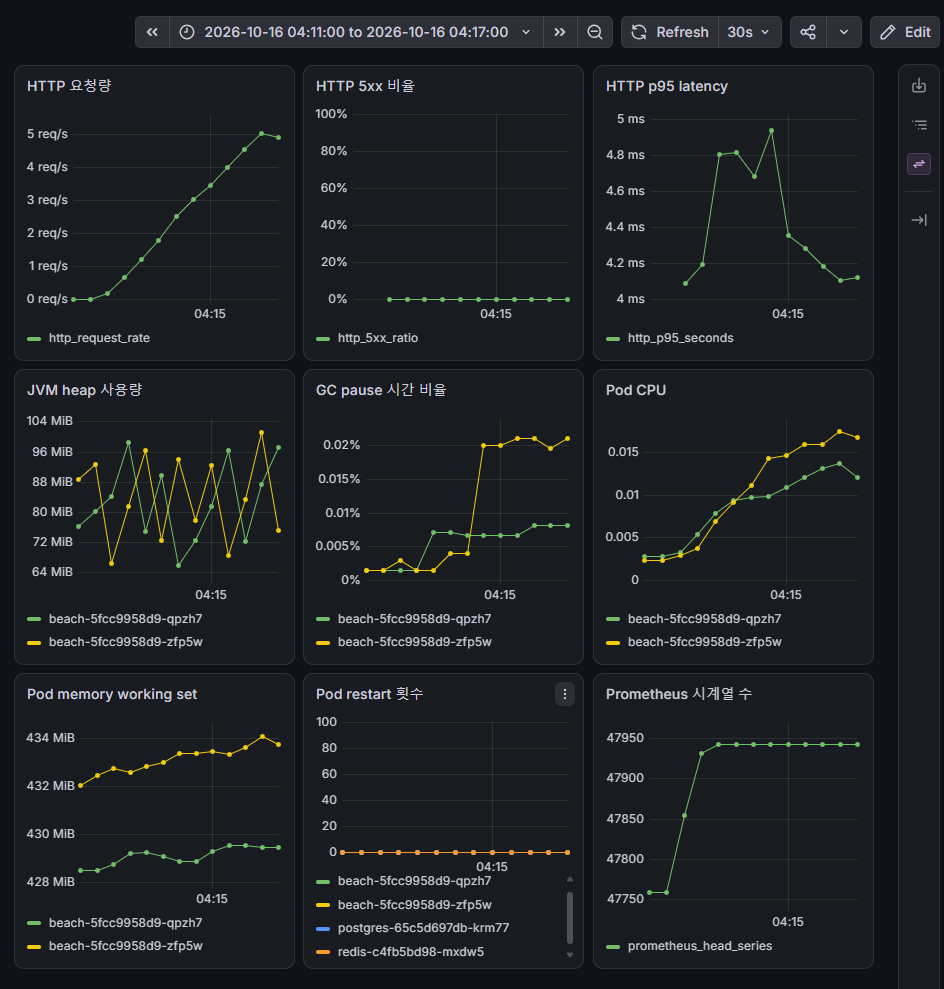

# 이슈 #5 관측 스택 검증 결과

## 현재 범위

2026-10-16(KST) 04:11~04:18에 수행한 한 회차를 기록한다. Beach에 5분 동안 일정한 부하(5 req/s)를 준 뒤 `verify-observability.sh`로 Prometheus target과 핵심 PromQL을 조회하고, 같은 시간대의 Grafana `Beach Overview`를 캡처했다.
관측 구성의 설치·접근 방법은 [deploy/k8s/observability/README.md](../../../deploy/k8s/observability/README.md)에 있다. 이 문서는 그 구성이 실제로 값을 내는지와 값의 해석을 다룬다.

## 실행 조건

| 항목 | 값 |
| --- | --- |
| 클러스터 | kubeadm, Control Plane 1·App Worker 2·Observability Worker 1. cp-1·obs-1은 t3.medium, app-1·app-2는 t3.small |
| Beach 이미지 | `ghcr.io/geonusp/beach_complex-k8s-poc-backend:latest`. PR #27 병합(`516e956d`) 이후 이미지이며 digest는 수집하지 않았다 |
| Beach Pod | replica 2, Pod당 CPU request 250m / limit 1, memory request 512Mi / limit 1Gi |
| 관측 스택 | `kube-prometheus-stack` 91.9.0 (Prometheus·Operator·Grafana·kube-state-metrics는 obs-1), Metrics Server 차트 3.14.0 |
| 수집 설정 | scrape 30s, 보존 2d / 5GB, `emptyDir` |
| 부하 | `run-load.sh 5 300`: `grafana/k6:2.3.0` Job(obs-1), `constant-arrival-rate` 5 req/s, 300초, `GET http://beach.beach.svc.cluster.local/api/beaches` |
| 부하 구간 | `load_started=2026-10-15T19:11:36Z` ~ `load_finished=2026-10-15T19:16:40Z` |
| 검증 | 부하 종료 직후 `verify-observability.sh` 실행. 스크립트가 `/api/beaches` 30회를 추가로 보내고 65초 기다린 뒤 2026-10-15T19:18:19Z에 PromQL을 조회했다 |

T3 CPU credit 모드와 실제 k6 Pod 노드는 결과에 수집하지 않았다.

## k6 결과 (클라이언트 측)

[k6-summary.json](k6-summary.json)에서 발췌했다.

| 지표 | 값 |
| --- | --- |
| 요청 | 1,501건, 5.003 req/s |
| 실패 / 5xx / 연결 실패 | `http_req_failed.rate` 0, `beach_status_5xx.count` 0, 연결 실패 0 |
| 검사 | 3,002회 통과, 0회 실패 |
| 누락된 반복 | 없음 (`dropped_iterations` 미기록) |
| 응답 시간 (`http_req_duration`) | 중앙값 3.06ms, 평균 3.87ms, p90 4.30ms, p95 5.90ms, p99 21.38ms, 최대 76.42ms |
| VU | 최대 2 |

## Prometheus target 상태

active target 26개 모두 `up`이며 `lastError`는 비어 있다.

| job | 개수 | 대상 |
| --- | --- | --- |
| `monitoring/beach` | 2 | Beach Pod `:8081/actuator/prometheus` (PodMonitor) |
| `apiserver` | 1 | `10.0.1.33:6443` |
| `coredns` | 2 | CoreDNS Pod `:9153` |
| `kubelet` | 12 | 노드 4개 × `/metrics`, `/metrics/cadvisor`, `/metrics/probes` |
| `node-exporter` | 4 | 노드 4개 `:9100` |
| `kube-state-metrics` | 1 | |
| `kube-prometheus-stack-grafana` | 1 | |
| `kube-prometheus-stack-operator` | 1 | |
| `kube-prometheus-stack-prometheus` | 2 | Prometheus `:9090`, config-reloader `:8080` |

etcd·kube-scheduler·kube-controller-manager·kube-proxy는 kubeadm 기본값에서 metrics를 `127.0.0.1`에만 바인드하므로 수집 대상에서 뺐다.

## `kubectl top` 결과

Metrics Server를 통해 `kubectl top node`와 `kubectl top pod -A`가 값을 반환했다.

| 노드 | CPU | 메모리 |
| --- | --- | --- |
| beach-complex-app-1 | 63m (3%) | 957Mi (53%) |
| beach-complex-app-2 | 90m (4%) | 1034Mi (57%) |
| beach-complex-cp-1 | 132m (6%) | 1741Mi (46%) |
| beach-complex-obs-1 | 100m (5%) | 1403Mi (37%) |

node-exporter를 제외한 monitoring Pod는 모두 `beach-complex-obs-1`에 배치됐고 재시작은 0이다.

## PromQL 값과 해석

값은 [verification.txt](verification.txt)의 조회 시점(19:18:19Z) 값이다. 시간에 따른 변화는 [Grafana 캡처](#grafana-대시보드)에서 본다.

| 지표 | 값 | 해석 |
| --- | --- | --- |
| `http_request_rate` | 3.61 req/s | 아래 "요청률" 참고 |
| `http_5xx_ratio` | 0 | k6의 5xx 0건과 일치 |
| `http_p95_seconds` | 3.51ms | 아래 "p95" 참고 |
| `jvm_heap_used_bytes` | 77.2MB / 90.0MB | 아래 "메모리" 참고 |
| `jvm_gc_pause_seconds_rate` | 0.000033 / 0.000185 s/s | 1초당 GC pause 0.003%·0.019%. 부하에 의한 pause 비중은 무시할 수준 |
| `pod_cpu_cores` | 0.0079 / 0.0116 cores | 아래 "CPU" 참고 |
| `pod_memory_working_set_bytes` | 450.5MB / 455.1MB | memory limit 1Gi의 약 43% |
| `pod_restarts_total` | 모두 0 | Beach 2, postgres, redis, k6 Pod. 이 출력은 k6 Job Pod 제외 필터(`pod!~"beach-k6-.*"`)를 추가하기 전 쿼리로 수집했다 |
| `prometheus_head_series` | 47,945 | 아래 "관측 비용" 참고 |

### 요청률: 5가 아니라 3.61인 이유

`rate(...[5m])`는 조회 시점 직전 300초의 평균이다. 조회 시각 19:18:19Z 기준 창은 19:13:19Z부터이며, 그중 k6 부하 구간과 겹치는 시간은 약 200초다.
`(200초 × 5 req/s + 검증 요청 30건) ÷ 300초 ≈ 3.44 req/s`로, 측정값 3.61과의 차이는 30초 scrape 간격과 `rate()`의 외삽 범위 안이다.
Grafana의 요청량 패널도 부하 시작부터 5분 동안 0에서 5 req/s까지 선형으로 오른 뒤 5 req/s에 도달한다. k6 요청률 5.003 req/s와 Prometheus 집계가 일치한다는 근거다.

### p95: k6 5.90ms와 Prometheus 3.51ms의 차이

- k6 값은 클라이언트에서 잰 시간이라 Service 라우팅·네트워크·연결 처리 시간을 포함한다. 서버 응답 대기만 본 `http_req_waiting` p95도 5.15ms다.
- Prometheus 값은 Spring의 `http.server.requests`로, 서버가 요청을 처리한 시간만 포함한다. 또 histogram bucket 사이를 선형 보간한 추정치다.
- 두 값 모두 수 ms이며 서버 측이 더 작게 나오는 방향이 맞다. Grafana에서 부하 구간 p95는 4~5ms 사이에서 움직였다.

### 메모리: heap과 Pod working set의 차이

heap 사용량은 77~90MB인데 Pod working set은 약 450MB다. Grafana에서 heap은 64~100MB 사이를 톱니 모양으로 오가고(young GC 주기), working set은 428~434MB 범위에서 거의 평평하다.
차이는 heap 밖의 JVM 메모리(metaspace, code cache, 스레드 스택, direct buffer)와 GC가 확보해 둔 heap 영역, 컨테이너의 page cache 등이다. 이번 회차에서는 영역별 크기를 수집하지 않았으므로 구성 비율은 단정하지 않는다.
따라서 Pod 메모리 사용률(HPA memory 기준이나 OOM 여유)은 heap이 아니라 working set으로 판단해야 한다.

### CPU

Grafana의 Pod CPU 패널에서 부하 전 Pod당 약 0.0025 cores(2.5m)였던 값이 부하 동안 0.012~0.017 cores(12~17m)까지 올랐다. 부하에 반응은 하지만 CPU request 250m의 5~7%, limit 1 core의 2% 미만이다.
조회 시점 값(7.9m / 11.6m)이 Grafana의 최댓값보다 낮은 것은 부하가 끝난 뒤 5분 창의 평균이기 때문이다.

## 관측 비용

| 구성요소 | 측정 사용량 | 설정 |
| --- | --- | --- |
| Prometheus Pod | 200Mi (`kubectl top`) | request 512Mi / limit 1536Mi |
| Grafana Pod (컨테이너 3개 합) | 402Mi (`kubectl top`) | grafana 컨테이너 request 512Mi / limit 1Gi |
| head series | 47,945 | 보존 2d / 5GB |

Grafana limit은 실클러스터에서 256Mi일 때 OOMKilled가 3회 발생해 1Gi로 올렸다(PR #29). obs-1 노드 메모리 사용률은 37%다.

## 이슈 #4(HPA) 입력값

| 상태 | Pod당 CPU (Grafana `Pod CPU`) | CPU request 대비 |
| --- | --- | --- |
| 유휴 | 약 2.5m | 약 1% |
| 5 req/s (Pod당 약 2.5 req/s) | 12~17m | 5~7% |

- 5 req/s로는 HPA CPU 목표(예: request의 50~70%)에 한참 못 미친다. #4에서는 훨씬 높은 부하가 필요하다.
- CPU가 요청률에 선형 비례한다고 가정하면, Pod당 125m(request의 50%)에 도달하려면 Pod당 약 20 req/s, 전체 약 40 req/s가 필요하다는 대략적 추정이 나온다. 선형 가정은 검증하지 않았으므로 #4에서 실측으로 확인한다.
- app 노드는 t3.small이라 기준 성능이 vCPU당 20%다. 높은 부하를 오래 주는 실험에서는 CPU credit 모드를 먼저 확인한다.

## Grafana 대시보드

부하 구간(2026-10-16 04:11~04:17 KST)의 `Beach Overview`다. 대시보드는 [beach-overview.json](../../../deploy/k8s/observability/dashboards/beach-overview.json)에서 자동 등록되며, 패널 쿼리는 `verify-observability.sh`가 조회하는 [promql-queries.tsv](../../../deploy/k8s/observability/promql-queries.tsv)와 같다.

처음 캡처에서 드러난 표시 문제(5xx 축 0~10000%, 시계열 수 축 라벨 중복, restart 범례의 k6 Job Pod)를 대시보드에서 고친 뒤, Prometheus에 남아 있는 같은 구간을 다시 그려 캡처했다. 부하를 다시 주지 않았으므로 값은 위 PromQL 결과와 같은 회차다.

## 완료 기준 대응

| 이슈 #5 완료 기준 | 근거 |
| --- | --- |
| Prometheus target이 정상 상태다 | [verification.txt](verification.txt) `== prometheus targets`: 26개 모두 `up` |
| `kubectl top node`와 `kubectl top pod`가 값을 반환한다 | [verification.txt](verification.txt) `== kubectl top node`, `== kubectl top pod` |
| 핵심 서비스 및 JVM 지표를 PromQL로 조회할 수 있다 | [verification.txt](verification.txt) `== promql`: 9개 쿼리 모두 값 있음, `NaN` 없음 |
| Grafana dashboard 또는 동등한 metric 증거가 남아 있다 | [beach-overview-load.png](beach-overview-load.png) |
| 관측 설정과 metric 해석이 문서화되어 있다 | [deploy/k8s/observability/README.md](../../../deploy/k8s/observability/README.md), 이 문서 |

## 한계

- **지표는 클러스터와 함께 사라진다.** Prometheus는 `emptyDir`이고 보존 기간은 2일이다. 이 회차의 증거는 위 파일뿐이다.
- **control plane 구성요소 지표가 없다.** etcd·scheduler·controller-manager·kube-proxy는 수집하지 않는다.
- **8081은 클러스터 내부에서 접근할 수 있다.** Service·Ingress에는 노출하지 않지만 NetworkPolicy가 없어 다른 Pod가 Pod IP로 `/actuator/**`에 접근할 수 있다.
- **kubelet scrape는 TLS 검증을 건너뛴다.** 차트 기본값 `insecureSkipVerify: true`를 유지했다.
- **단일 요청 경로, 낮은 부하다.** `GET /api/beaches` 5 req/s만 측정했으므로 다른 API나 높은 부하에서의 지연·자원 사용으로 일반화하지 않는다.
- **한 회차다.** 반복 측정이 아니므로 값의 분산은 제시하지 않는다.

## 원본 증거

- [verification.txt](verification.txt): `verify-observability.sh` 출력. SHA-256 `7ec034c94e261f181b4fab11c6b1ec84808d8eb648e6781c08c057dcc5471776`.
- [k6-summary.json](k6-summary.json): k6 `handleSummary` 요약 한 줄. SHA-256 `c2d30b529bbb9b8c6deb76e5b888a46d5d241ce93989286c40c20a1cc268cb3c`.
- [beach-overview-load.png](beach-overview-load.png): Grafana `Beach Overview` 캡처. SHA-256 `4549fd3c03f0aa6884fa56639da58475a14c75940035f9b0d7812070d96d73b7`.
- k6 전체 출력(진행 로그, 요청 단위 원본 JSON 포함, 6.7MB)의 로컬 회수 위치: `deploy/k8s/loadtest/results/load/20261015T191130Z-9404/remote-output.txt` (`.gitignore` 대상). SSM S3 출력 prefix는 `rollout/load/20261015T191130Z-9404/`이다.
